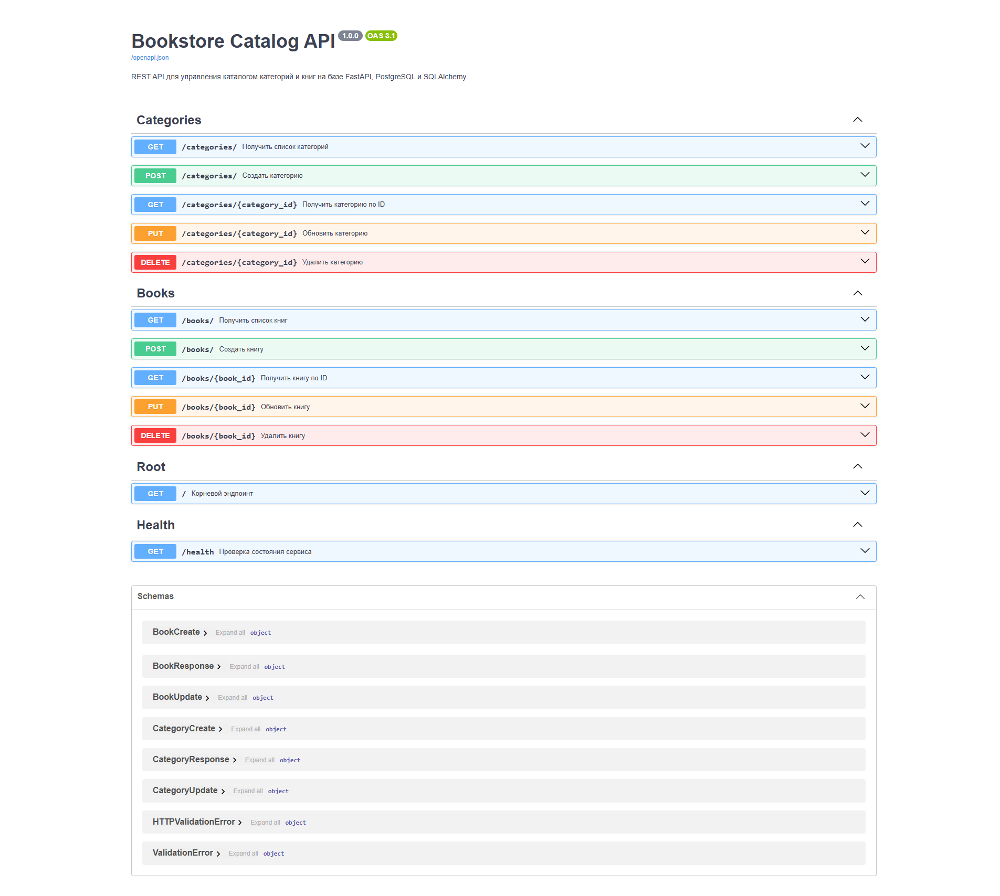
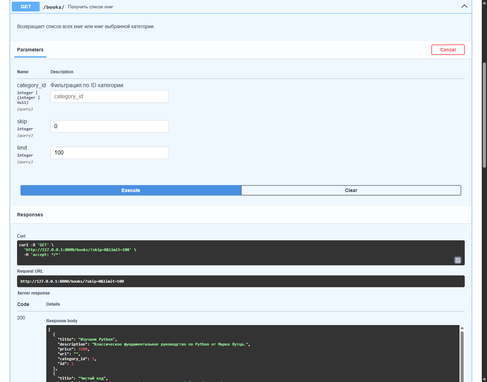

# REST API каталога книг на FastAPI и PostgreSQL

Репозиторий содержит REST API для управления каталогом книг и категорий с использованием веб-фреймворка FastAPI, ORM SQLAlchemy и СУБД PostgreSQL в среде WSL 2 (Ubuntu).

## Выполненные требования

- Установлены зависимости: `fastapi`, `uvicorn`, `SQLAlchemy`, `psycopg2-binary`, `pydantic`, `python-dotenv`.
- Разработаны Pydantic-схемы валидации запросов и ответов в модуле `app/schemas.py`.
- Созданы маршрутизаторы API с операциями CRUD:
  - `/categories`: получение списка, просмотр по ID, создание, редактирование и удаление категорий.
  - `/books`: получение списка с фильтрацией по категории (`?category_id=`), просмотр по ID, создание, редактирование и удаление книг.
- Настроена валидация связей: проверка существования категории при создании и обновлении книг.
- Добавлен служебный эндпоинт проверки работоспособности `/health`.
- Настроена автоматическая генерация OpenAPI-документации (Swagger UI по адресу `/docs`).
- Подготовлена база данных и скрипт первичной загрузки данных `app/init_db.py`.

## Структура проекта

```text
python-fastapi-postgres/
├── app/
│   ├── api/
│   │   ├── __init__.py
│   │   ├── books.py
│   │   └── categories.py
│   ├── db/
│   │   ├── __init__.py
│   │   ├── crud.py
│   │   ├── db.py
│   │   └── models.py
│   ├── init_db.py
│   ├── main.py
│   └── schemas.py
├── examples/
│   ├── api_request.png
│   └── swagger_docs.png
├── .env.example
├── .gitignore
├── README.md
└── requirements.txt
```

## Эндпоинты API

| Метод | Путь | Описание | Код ответа |
|---|---|---|---|
| `GET` | `/health` | Проверка доступности сервиса | 200 |
| `GET` | `/categories/` | Список всех категорий | 200 |
| `GET` | `/categories/{id}` | Получение категории по идентификатору | 200 / 404 |
| `POST` | `/categories/` | Создание новой категории | 201 / 400 |
| `PUT` | `/categories/{id}` | Изменение названия категории | 200 / 404 |
| `DELETE` | `/categories/{id}` | Удаление категории и связанных книг | 204 / 404 |
| `GET` | `/books/` | Список всех книг (с фильтром `?category_id=`) | 200 / 404 |
| `GET` | `/books/{id}` | Получение книги по идентификатору | 200 / 404 |
| `POST` | `/books/` | Добавление книги | 201 / 400 |
| `PUT` | `/books/{id}` | Обновление полей книги | 200 / 404 |
| `DELETE` | `/books/{id}` | Удаление книги | 204 / 404 |

## Установка и запуск

1. Клонируйте репозиторий:

```bash
git clone https://github.com/ArtemChik103/python-fastapi-postgres.git
cd python-fastapi-postgres
```

2. Создайте и активируйте виртуальное окружение:

```bash
python3 -m venv venv
source venv/bin/activate
```

3. Установите зависимости проекта:

```bash
pip install -r requirements.txt
```

4. Скопируйте файл конфигурации и укажите параметры подключения к базе данных:

```bash
cp .env.example .env
```

5. Инициализируйте таблицы и тестовые записи в PostgreSQL:

```bash
python app/init_db.py
```

6. Запустите сервер FastAPI через Uvicorn:

```bash
uvicorn app.main:app --reload --host 0.0.0.0 --port 8000
```

7. Откройте интерактивную документацию Swagger в браузере:

```text
http://127.0.0.1:8000/docs
```

## Результаты тестирования

### Интерактивная документация Swagger UI


### Пример выполнения запроса к API

